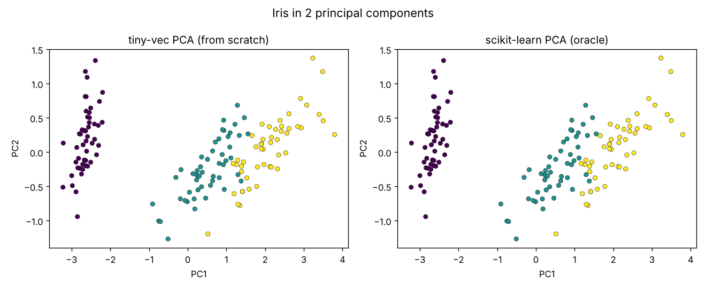

# tiny-vec

[](https://github.com/kashyap963hvk-afk/WEEK-01--tiny-vec-/actions/workflows/ci.yml)

Pure-Python linear algebra, Strassen matrix multiplication, SVD/PCA via power
iteration, and a reverse-mode autograd engine built from first principles —
benchmarked against NumPy and scikit-learn.

No NumPy inside the library. NumPy and scikit-learn appear **only in the tests**,
as the oracle we check ourselves against.

| Module | What it is |
| --- | --- |
| `tiny_vec/vector.py` | `Vector`: add/sub/scale, dot, p-norms, normalize |
| `tiny_vec/matrix.py` | `Matrix`: transpose, naive O(n³) matmul, Strassen O(n^2.807) |
| `tiny_vec/engine.py` | `Value`: scalar reverse-mode autodiff (+, *, **, /, relu, tanh, exp) |
| `tiny_vec/nn.py` | `Neuron` → `Layer` → `MLP`, built only from `Value` |
| `tiny_vec/linalg.py` | `power_iteration`, `svd` (power iteration + deflation), `pca` |

## Quick start

```bash
python -m venv .venv && source .venv/bin/activate
pip install -e ".[dev]"
pytest --cov=tiny_vec --cov-report=term-missing
```

```python
from tiny_vec import Value
v = Value(2.0)
(v * v).backward()
print(v.grad)  # 4.0
```

## Results

### 1. Pure Python vs NumPy (128×128 matmul)

```
tiny-vec 0.095s  numpy 0.00043s  -> numpy 221x faster
```

NumPy hands the work to an optimized BLAS: contiguous memory, SIMD, cache
blocking, multiple threads, and zero interpreter overhead per multiply-add. Our
version pays for a Python bytecode dispatch and a boxed `float` on every one of
the ~2 million multiply-adds.

### 2. Strassen vs naive — the honest crossover

`python bench/matmul.py --sizes 64,128,256,512 --leaf 32`

|    n | naive (s) | strassen (s) | winner |
| ---: | --------: | -----------: | :----- |
|   64 |    0.0128 |       0.0171 | naive |
|  128 |    0.1008 |       0.1469 | naive |
|  256 |    0.8403 |       0.8344 | ~tie (flips run to run) |
|  512 |    9.3687 |       5.7114 | **strassen (1.6×)** |

The textbook says Strassen pays off around n≈128. In pure Python it doesn't: the
crossover is **around n=256**, and Strassen only wins clearly at 512. Strassen
trades one multiply for 18 extra matrix additions per level, and in Python every
one of those additions is an interpreted loop with real constant cost. The
asymptotics are right; the constants just move the crossover up.

### 3. Autograd learns XOR

`python examples/train_xor.py` — a 2→8→8→1 MLP (105 params), trained with plain
SGD on our own `Value` engine:

```
epoch    0  loss 0.897416
epoch  200  loss 0.000004
FINAL loss 0.000000
  [0.0, 0.0] -> +0.000 (target 0.0)
  [0.0, 1.0] -> +1.000 (target 1.0)
  [1.0, 0.0] -> +1.000 (target 1.0)
  [1.0, 1.0] -> +0.000 (target 0.0)
PASS: loss < 0.01
```

Gradients are verified against central finite differences in `tests/test_math.py`.

### 4. PCA on iris (our SVD vs scikit-learn)

`python examples/pca_iris.py` — PC1 captures 94.6% of the top-2 variance.



The two projections match to 1e-4 (up to the sign of each axis, which is
arbitrary for any SVD).

## Coverage

```
Name                   Stmts   Miss  Cover
------------------------------------------
tiny_vec/__init__.py       7      0   100%
tiny_vec/engine.py        83      1    99%
tiny_vec/linalg.py        59      0   100%
tiny_vec/matrix.py        98      9    91%
tiny_vec/nn.py            38      1    97%
tiny_vec/vector.py        48     14    71%
------------------------------------------
TOTAL                    333     25    92%
15 passed
```

## Build & publish (TestPyPI)

```bash
pip install build twine
python -m build                                  # -> dist/*.whl, dist/*.tar.gz
twine upload --repository testpypi dist/*        # needs a TestPyPI API token
python -m venv /tmp/fresh && source /tmp/fresh/bin/activate
pip install -i https://test.pypi.org/simple/ tiny-vec
python -c 'from tiny_vec import Value; v=Value(2); (v*v).backward(); print(v.grad)'  # 4.0
```

## Layout

```
tiny_vec/    the library (pure Python, zero dependencies)
tests/       pytest + hypothesis, NumPy/scikit-learn as oracles
bench/       matmul.py — naive vs Strassen timing
examples/    train_xor.py, pca_iris.py
docs/        iris_pca.png, blog post
```

Write-up: [I built tiny NumPy and learned why NumPy is fast](docs/blog.md)

## License

MIT
